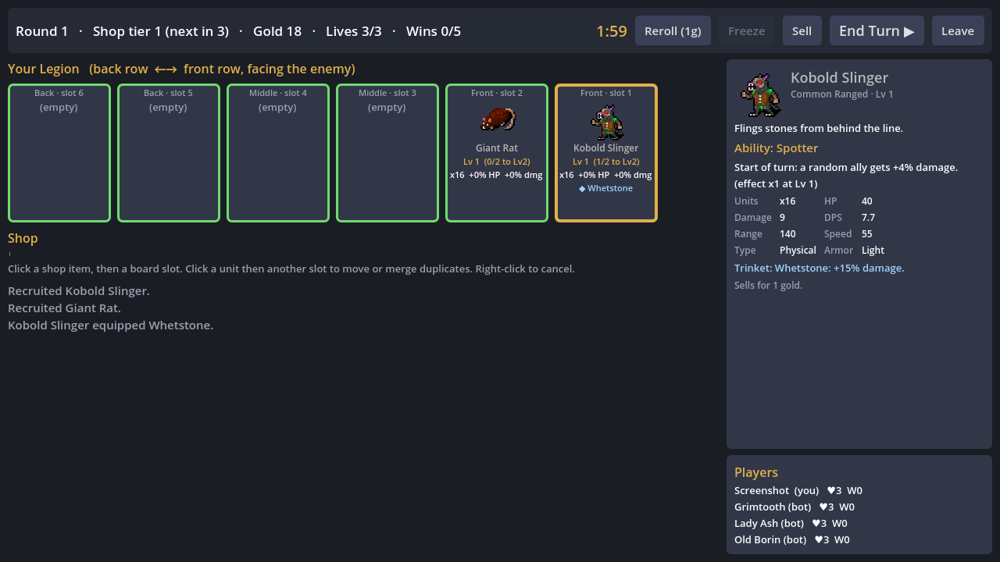
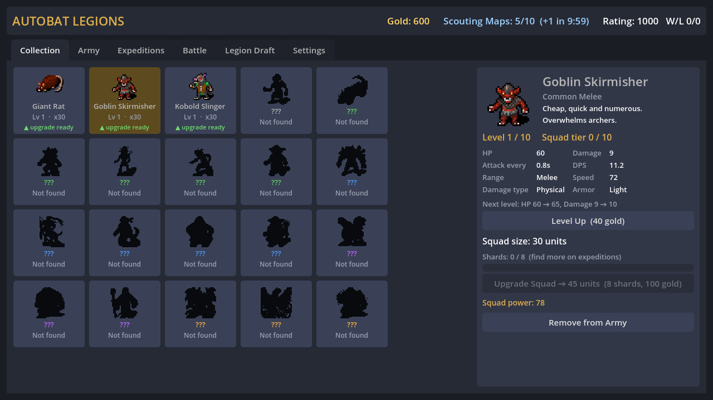

# Autobat Legions

An auto-battler PvP game for **Godot 4.3+**. You hunt down specific units, level them up,
grow their squad sizes, and send armies of **1000+ units** against other players'
armies in fully automatic battles across **20 battlefields**.

All art, sound and music are **CC0 open-source assets** (see [CREDITS.md](CREDITS.md)).

| Battle (Twin Fords) | Legion Draft shop |
|---|---|
|  |  |
| **Collection** | **Battlefields** |
|  |  |

## Running it

1. Install [Godot 4.3 or newer](https://godotengine.org/download) (standard build; C# not needed).
2. Open Godot → **Import** → pick this folder's `project.godot`.
3. Press **F5** (Play).

The first time it opens, the editor imports the assets, which takes a few seconds.

**Fullscreen:**
- **Exported desktop builds** start fullscreen. Running from the editor stays windowed unless
  you turn fullscreen on.
- **Switching:** the **Fullscreen / Windowed** button in the top bar, **F11** (or Alt+Enter), or
  **Settings → Display**. Your choice is remembered.
- **In a browser,** the game fills the page and the button switches the browser to fullscreen.
- **Scaling:** the interface scales with the screen size, and wider screens show more of the
  layout.

**Desktop builds:** **Project → Export** has presets for **Windows Desktop**, **Linux** and
**macOS** (plus Android, iOS and Web). Install Godot 4.3's export templates once (Editor → Manage
Export Templates).

**Everything at once:** `tools/export_all.sh /path/to/godot` builds the web, Windows, Linux and
Android versions into `export/legion-<version>/`, e.g. `export/legion-0.7/` with
`legion-0.7-windows.zip`, `legion-0.7-linux.zip`, `legion-0.7-android.apk` and
`legion-0.7-web.zip`.

**Versions:** there are two version numbers.
- **The release version** (currently **0.8**) is what players see on the sign-in screen, in
  Settings and in update prompts, and it names the builds. It's set in Project Settings →
  Application → Config → Version.
- **For a new release:** also raise the Android `version/code` in `export_presets.cfg`
  (currently 8). Android only installs updates with a higher code.
- **`GAME_VERSION`** in `scripts/net/party.gd` (e.g. `legion-draft-12`) is the compatibility
  number between game and server. Bump it whenever an update changes how they talk to each other.
- **Templates:** fetch only the export templates you need with
  `python3 tools/fetch_export_templates.py web windows linux android`.
- **Android** also needs Java and the Android SDK (`ANDROID_HOME`).
- **The Android release key:** set `GODOT_ANDROID_KEYSTORE_RELEASE_PATH` / `_USER` /
  `_PASSWORD` to sign with it. **Keep that key safe:** Android only installs updates signed with
  the same key.

**Phones and tablets:** the game also runs on Android and iOS, with scaled-up text and buttons,
touch controls and pinch-to-zoom. See **[MOBILE.md](MOBILE.md)** for how to build it.

**In a web browser:** an HTML5 build plays online through the server (over WebSocket) or
offline as a guest. Only LAN matches and live duels need the downloadable version. The server
can host the page itself for your home network. See **[WEB.md](WEB.md)**.

**Putting it online:** [HOSTINGER.md](HOSTINGER.md) sets up a Hostinger VPS (or any Ubuntu
server) with your domain: the game server plus the browser version over HTTPS, in one script.

**Accounts:** at startup, sign in to (or create) an account on the server, which then keeps your
progress, or press **Play offline (guest)** to keep a local profile on this device. You can
switch later in **Settings → Account**. See [HOSTING.md](HOSTING.md#accounts-and-security) for how
accounts, password hashing and encryption work.

## The gameplay loop

**Rating unlocks regions.** Each expedition region needs a ranked rating, spread out from the
start to the top:

| Rating | Regions |
|---|---|
| 0 | Goblin Warrens, Haunted Crypt, Badlands Camp* |
| 1100 / 1200 | Sunken Marsh*, Hive Tunnels* |
| 1300 | Whispering Forest |
| 1500 / 1700 | Elven Glade*, Bone Fields* |
| 1900 | Dwarven Deeps |
| 2200 | Giant's Steps* |
| 2500 | Dragon Peaks |
| 3000 | Dragon's Hoard* |
| 3500 | Celestial Spire* |

\* locked until the server admin releases them (see Locked units). Generated ranked opponents
use rarer units at roughly the same points (rare from 1200, epic from 1700, legendary from
2500).

1. **Find units: Expeditions tab.** Spend *Scouting Maps* to search a region. Your scouts come
   back with **3 different units** from that region, each shown with its description, role,
   stats and strengths, and you **recruit one**. A new unit joins your collection; one you
   already own gives **shards** for that unit. Each region has its own drop table, so to hunt a
   specific unit you pick where to look (e.g. Golden Dragons only appear in Dragon Peaks); the
   region card shows each unit's chance to be offered. The choice is saved, so closing the game
   doesn't reroll it. Maps refill (1 per 10 minutes, max 10) and ranked wins award more.
   **Legendaries are rare:** their drop weight is halved, and in Dragon Peaks a Golden Dragon
   is offered about 7% of the time.
   **Guaranteed pulls:** if 4 expeditions in a row offered nothing Rare or better, the 5th is
   guaranteed to include one. Epic or better is guaranteed every 15 expeditions, and Legendary
   every 60 (counting only regions that have legendaries). The tab shows the countdowns, and the
   guaranteed unit is marked on its card.
   - **Server settings:** the server admin can change all of these, and trinket odds, with the
     `drops` command (see [HOSTING.md](HOSTING.md)).
   **Trinket hunts: Expeditions → Trinkets.**
   - **Hunting:** spend maps at one of three sites to turn up **3 trinkets** and keep **one**:
     - **Abandoned War Camp:** 1 map, mostly common.
     - **Sunken Vault:** 2 maps, rating 1050.
     - **Dragon's Trove:** 3 maps, rating 1200, best legendary odds.
   - **The collection:** there are **100 unique trinkets** to collect (30 common, 25 uncommon,
     20 rare, 15 epic, 10 legendary). Examples: +HP, +damage, faster attacks, speed, range,
     splash, regeneration, lifesteal, thorns, extra units in the squad, damage/armor type
     changes, and flying.
   - **Duplicates:** hunts prefer trinkets you don't own yet. A trinket you already have is sold
     for gold.
   - The sub-tab shows each site's odds and your whole collection.
2. **Level up: Collection tab.** Spend gold to raise a unit's level (+8% HP and damage per level).
   **Trinkets:** each unit has **2 trinket slots**. Equip, swap or remove them in the unit's
   details panel. A trinket can only be on one unit at a time, so equipping it elsewhere moves
   it. Trinkets go into battle with the army and into its army code.
3. **Increase quantity: Collection tab.** Spend shards and gold to raise the squad tier, which
   adds units to the squad. Each tier also raises the level cap by 4.

   | Rarity | Squad size at tier 0 → tier 10 |
   |---|---|
   | Common | 30 → 180 |
   | Uncommon | 15 → 95 |
   | Rare | 6 → 36 |
   | Epic | 2 → 12 |
   | Legendary | 1 → 11 |
   **Strength (army power):** each squad's power is its units' power (HP × damage, range and
   rarity) times the unit count.
   - **Melee and tank squads** count their size as count^0.85: twice the units ≈ 1.8× the power,
     because only the front of a crowd reaches the enemy (measured in the battle simulator).
   - **Ranged units, casters and healers** count every unit.
4. **Build an army: Army tab.** Up to 8 squads. There is **no unit cap**: every squad fights at
   full size, so a maxed army of commons and uncommons is about 1,100 units per side.
   - **Columns:** the tab has three columns, **Back line | Middle | Front line**, laid out like
     the battlefield, with the front line on the right facing the enemy.
   - **Moving squads:** drag a squad to another column (or use ◀ ▶); ▲ ▼ set the order within
     a column.
5. **Fight: Battle tab.**
   - **Ranked Arena:** **Find Opponents** saves your army on the server with your current rating
     and matches you against armies that **other players saved at a similar rating**: one close
     match, one slightly lower and one slightly higher. Win rating (Elo), gold and maps. Empty slots, or all three when offline, are
     filled with generated training opponents.
   - **Win gold grows with your rating:** x1 up to 1000, then +100% for every 1000 above that
     (x2 at 2000, x3.5 at 3500). The Battle tab shows your current bonus. Losses and draws pay
     the same at any rating.
   - **Only nearby players:** you're only matched against saved player armies within **±200
     rating** of yours (the server admin can change this). If nobody is that close, training
     opponents fill in.
   - **Flying hunters:** some flyers ignore the nearest enemy and go after a kind of target
     anywhere on the field (shown with ⚑ in the Collection):
     - **Ranged units and casters:** Griffon, Tengu Warrior, Sphinx.
     - **Healers:** Cave Bat, Phoenix; they go for ranged units once the healers are gone.
     - **The back line:** Hippogriff, Bone Dragon.
   - **Battles play out in full** (there's no skip button; use 2× or 4× speed).
     - **The effects:** a roll of war drums and a FIGHT! banner, hit flashes, slash and spark effects,
       death puffs, shockwaves and screen shake for big splash attacks and falling giants, and
       a VICTORY / DEFEAT banner with a music sting.
     - **Music:** the lobby plays four tracks as a playlist (never the same one twice in a row).
       Battle music varies between three tracks, and challenge bosses get their own theme.
     - **Ability sounds:** every battle ability has its own sound (zaps, ice, fire, shattering
       glass, chimes, ghostly breath...), spaced out so big battles stay calm.
     - **Screen shake** can be turned off in Settings.
   - **Training opponents:** a hard ladder.
     - **Strength:** Easy ≈ 0.9×, Even ≈ 1.1×, Hard ≈ 1.5× your power by default (the server can change this with `difficulty`). Against an ordinary
       army of your power, the simulator measures roughly 55% / 21% / 5% to win; a well-built
       army does better.
     - **Rating:** they are rated 40 below, 60 above and 150 above you. Harder wins pay more
       rating, but less than the odds would suggest, so no difficulty is a free climb.
     - **Trinkets:** above rating ~950 they carry trinkets too, more and rarer as rating rises.
   - **Rating speed (Elo K-factor):** 24 up to rating 1200, falling steadily to 12 at 3000 and
     above. An even win is worth about +12 at the start and +6 near the top.
   - **Challenges tab:** 12 hand-made battles in three chapters (Border Skirmishes, The Wild
     Frontier, Dragon Lands).
     - **The fights:** set enemy armies on chosen battlefields, including three challenge-only
       maps: the Narrow Bridge, the Fortress Gate and the Dragon's Lair. Some have named bosses:
       single units with boosted stats, from Gruk the Unbreakable (an ogre) to Aurathrax the
       Golden Wyrm.
     - **Progression:** each card shows the enemy army, the boss and a **recommended power**
       (measured by simulation). Clearing one unlocks the next.
     - **Rewards:** a fixed reward for the first win: gold, maps, specific trinkets, and units
       such as the Ogre Brute, Lich, Phoenix and Golden Dragon. Replays pay nothing.
     - **Signed in:** the server runs the battle and pays the reward.
   - **Look:** the fantasy skin (dark wood panels, gold trim, parchment, scroll rods, stone backdrop)
     is drawn from noise at startup by `scripts/ui/fantasy_skin.gd`; headings use the Cinzel font.
     `ScrollUnroll` (`scripts/ui/scroll_unroll.gd`) is the unrolling scroll used for ranked
     opponents and patch notes.
   - **Tutorial:** new players are guided through the basics by doing them, with a spotlight on the
     next thing to press. It covers a first battle, a level up, an expedition, the army, a ranked
     fight and a challenge. Tips appear the first time trinkets, Legion Draft and the leaderboard are
     opened. Skip it at any time; replay it from Settings. The steps are in
     `scripts/ui/tutorial.gd` (targets are marked with `UIKit.tut(control, "id")`).
   - **Patch Notes tab:** balance changes by version, newest first. A red dot marks it until you've
     opened the current version's notes. Edit `scripts/core/patch_notes.gd` to add a patch.
   - **Leaderboard tab:** the top 50 signed-in players by rating (players need at least one
     ranked battle), with your own rank. Guests can view it but aren't on it.
   - **Friend Challenge:** paste a friend's *army code* (Army tab → Copy) to fight their exact army.
   - **Live Duel:** one player hosts, the other joins by IP (LAN, or the internet with a forwarded
     UDP port, default 24680). Ranked.
   - **Battlefield picker:** choose one of the 20 maps (or Random) for friend challenges and duels
     you host. Each ranked opponent card shows the map you'll fight on.

## Locked units

There are **60 units**. The original 20 are open. **40 more are locked** until you release them:
- **Commons:** Jackals, Hobgoblins, Cave Bats, Goblin Archers and more.
- **Uncommons:** Knights, Hippogriffs, War Hounds, Elven Mages and more.
- **Rares:** Trolls, Cyclopes, Minotaurs, Vampire Knights and more.
- **Epics:** Giants, the Sphinx, an Ice Dragon, a Hydra, a Bone Dragon and a Juggernaut.
- **Legendaries:** the Shadow Dragon, Storm Dragon, Seraph and Grand Avatar.

Locked units don't appear anywhere: not in expeditions, draft shops or ranked opponents, and not
in army codes. Locked units you own sit out of battles.

The new units come from **8 new expedition regions**, which are locked too:
- **Opening regions (1 map):** Badlands Camp (no rating needed), Sunken Marsh (1100), Hive
  Tunnels (1200).
- **Mid regions (2 maps):** Elven Glade (1500), Bone Fields (1700), Giant's Steps (2200).
- **Top regions (3 maps):** Dragon's Hoard (3000), Celestial Spire (3500).

The original 5 regions keep their original 20 units. A locked region is hidden from the
Expeditions tab, and a region can only be explored once some of its units are unlocked.

The Legion Draft server controls the locks (`units`, `regions`, `lock`, `unlock`,
`lock region`, `unlock region`, and `unlock new` to release everything new; see HOSTING.md). Any
unit, old or new, can be locked as an emergency balance fix. Players' games pick up the server's
locks when they connect. The defaults live in `scripts/core/game_data.gd` (`"locked": true`).

## Legion Draft (multiplayer game mode)

A separate mode for a group of players, picked from the **Legion Draft** tab. It uses no
collection: everyone drafts an army from scratch each match.

- **Shop rounds:** each round you get 10 gold. Units and trinkets cost 3, rerolling costs 1, and
  frozen items stay in the shop for the next round.
- **Drag and drop:** drag shop units and trinkets onto your board. Drag a unit to another slot
  to move or swap it, onto a matching unit to merge, or onto **Sell**. Valid slots light up
  green while you drag. Clicking an item and then a slot also works.
- **Board:** 4, 6 or 8 slots, chosen when the match is created.
  - 4 slots: 2 front line, 2 back row.
  - 6 slots: 2 front, 2 middle, 2 back.
  - 8 slots: 3 front, 2 middle, 3 back.
- **Duplicates level up:** drop a copy onto the same unit, or merge two board units. Lv2 needs 3
  copies and Lv3 needs 6. Each level makes the squad bigger (common: 16 → 32 → 48 units) and
  stronger (+40% per level).
- **Out-of-battle abilities:** each of the 20 units has its own, triggered when bought, sold or
  levelled up, at the start or end of a turn, when given a trinket, when an ally is sold, or
  after a win or loss. Examples: Rats breed +2 units each turn, the Golden Dragon earns gold, and
  the Lich grows stronger whenever you sell an ally.
- **Trinkets:** 18 across 6 tiers. Held trinkets change how a squad fights: lifesteal, thorns,
  splash, flying, magic damage, faster attacks, +50% units, and more. Consumables give permanent
  boosts or an extra copy toward the next level.
- **Shop tier:** rises every 3 battles, from 1 to 6. Tier 2 unlocks uncommon units, 3 rare, 4 epic
  and 5 legendary, and each tier adds stronger trinkets and more shop slots.
- **Matches:** after each shop phase, players are paired against each other; an odd player out
  fights a copy of another player's army. Play until you hit the win target (default 10) or run
  out of lives (default 5). Final placings award gold and scouting maps in the main game; the
  amounts are set by the server (see the admin commands in HOSTING.md).
- **Rule toggles:** when creating a match you can switch off the **win target**, the **lives**
  and the **turn timer**.
  - Without lives, nobody is knocked out and the match ends after a **round limit**, ranked by
    wins, then fewest losses.
  - Without a timer, each shop phase waits until everyone presses End Turn.
- **Online play:** this uses the matchmaking server; see **[HOSTING.md](HOSTING.md)** for how
  to run your own. On a home Windows PC, run `server\start_server_windows.bat`.
  - **Quick Match** joins an open room. Rooms start on their own and fill empty seats with bots.
  - **Create Match** makes a public room or a private one with a 5-letter code.
  - **Browse** lists public rooms, and you can join any room by its code.

  Nobody needs to forward ports.
- **Local network play** needs no server:
  - **Quick Match (LAN)** joins a match on your network, or hosts one if none is found.
  - **Host Match** lets you set wins, lives, max players (2–16) and turn time, and add bots.
  - **Find Matches** lists matches on your network.
  - **Join by IP**.
- **Disconnects:** a player who drops mid-match is replaced by a bot.
- **Cheat-proof:** whoever runs the match (the server, or the LAN host) keeps every player's
  shop and board. Clients send only their actions (buy, sell, move…). The authority replays
  them through the same rules code and random numbers, so a modified client can't fake its
  army. The authority also decides every battle, on worker threads, and players watch a replay
  of their own fight.

Rules and content live in `scripts/draft/draft_data.gd`, the shop and ability logic (plus the bot
player) in `scripts/draft/draft_run.gd`, a match's authoritative logic in
`scripts/net/match_room.gd`, and networking in `scripts/net/party.gd`. The dedicated server
is this same project run headless: `godot --headless -- --server` (Docker setup in `server/`).

### Battlefields

20 maps (`scripts/core/battle_maps.gd`), each with its own floor, size (2200–3000 px wide) and
terrain. The terrain is lakes, rivers with fords, lava, bogs, rocks, walls, crystals, tree groves,
pillars and statues. Obstacles block ground units, which steer around them; **flying units pass
over them**. Every map is mirrored left/right so neither side has an advantage.

| | | | |
|---|---|---|---|
| Open Arena | Goblin Warrens | Haunted Crypt | Whispering Forest |
| Dwarven Deeps | Dragon Peaks | Twin Fords | Frozen Lake |
| Sunken Swamp | Desert Dunes | Mossy Ruins | Mudflats |
| Glacier Pass | Marble Court | Crystal Caverns | The Hive |
| Tomb of Kings | Blood Plains | Infernal Gate | Serpent Bog |

To add a map, add an entry to `MAPS` with a floor tile and a list of `[kind, x, y, radius]`
obstacles (x/y as fractions of the map; anything left of centre is mirrored automatically).

### Combat

- 20 units in 5 rarities, each with a role (melee, ranged, caster, healer, tank).
- Damage types (physical / pierce / magic / fire) against armor classes (light / heavy / undead / beast)
  make for counters: arrows shred light infantry but bounce off heavy armor and skeletons, fire burns
  undead and treants, magic melts heavy armor.
- Splash damage (capped at 6 targets per hit), healers, regeneration, and flying units (melee hits
  them for only 60%).
  - **Who splashes:** only six units splash (patch 0.9.2): Orc Sorcerer, Hill Giant, Cyclops, Fire
    Giant, Golden Dragon and Grand Avatar.
  - **Melee splash** hits nearby enemies for 45% of the blow (60% before 0.9.2).
  - **Projectile splash** (stones, magic, fire) hits them for 35% (60% before patch 0.9, 45% in
    0.9).
- **Battle abilities** (patch 0.9.2): 23 units have one, including every epic and legendary,
  each with an ability no other epic or legendary shares. They're shown on each unit's card and
  simulated in `BattleSim` (`Ab`); see `GameData.ABILITIES`.

  | Ability | Units | Effect |
  |---|---|---|
  | Stun | Ogre Brute (0.6s) | The target can't move or attack. |
  | Chill | Ice Dragon (3s) | Half speed, moving and attacking. |
  | Burn | Salamander Firebrand | 150% of the hit again as burn damage over 4s. |
  | Chain Lightning | Elven Mage (2), Storm Dragon (5) | Jumps to more enemies nearby, each jump 30% weaker. |
  | Shatter | Frost Giant (4s) | The target takes 30% more damage from everyone. |
  | Wither | Sphinx (4s) | The target deals 35% less damage. |
  | Charge | Minotaur | The first blow against each new target deals 3x damage. |
  | Double Strike | Ettin | Each blow also hits a second enemy in reach. |
  | Rebirth | Phoenix | Rises again once at full health. |
  | Unstoppable | Juggernaut | Immune to stun and chill, 35% less damage from projectiles. |
  | Devour | Shadow Dragon | Heals for 75% of the damage it deals. |
  | Raise Dead | Lich | Its victims rise as skeletons on its side (up to 8 per Lich). |
  | Quake | Hill Giant | Every third blow stuns every enemy around the target for 0.8s. |
  | Predator | Griffon | +150% damage to ranged units, casters and healers. |
  | Knockback | Stone Giant | Boulders hurl the target back and knock it down briefly. |
  | Molten Core | Fire Giant | Erupts when it dies: 35% of its health as fire damage nearby. |
  | Many Heads | Hydra | +40% attack speed for each quarter of its health lost (up to 3). |
  | Soul Harvest | Bone Dragon | Each kill heals 20% and adds +10% damage (up to +50%). |
  | Dread | Golden Dragon | Enemies nearby deal 35% less damage. |
  | Rising Storm | Storm Titan | Each blow adds +5% damage, up to +100%. |
  | Resurrection | Seraph | Every 4s brings the latest fallen ally nearby back at half health. |
  | Divine Aegis | Grand Avatar | Allies nearby take 20% less damage. |

  - **Squad growth:** epic and legendary squad upgrades cost 1.75× and 2× the shards.

  - **Strength:** each ability's worth in Strength (`Army.ABILITY_TUNING`) is calibrated with
    `tools/balance_sim.gd`.
- Battle controls: mouse wheel to zoom, drag to pan, 1x/2x/4x speed, skip to result.

## How the 1000+ unit battles work

- `scripts/battle/battle_sim.gd`: the simulation uses no physics or scene nodes. Unit state is
  stored in packed arrays (one array per stat), with a uniform spatial grid for target search,
  splash and separation. It runs at a fixed 20 ticks per second. Ground units walk around
  circular obstacles using a sticky detour direction (they follow a river until they find a
  ford, and turn back if they reach a dead end).
- `scripts/battle/battle_view.gd` draws all units with one `MultiMeshInstance2D` per unit type
  (about 20 draw calls for 2000 sprites), interpolating positions between ticks.
- **Deterministic:** the same armies plus the same seed always give the same battle. Live duels
  rely on this. Both players exchange army codes, the host picks a seed and map, each machine simulates
  the battle locally, and the two results are compared by checksum.

## PvP: what's real

- **Signed-in players:**
  - **Server-side progress.** The profile lives on the server. Every upgrade, expedition roll
    and army change is applied by the server's copy of the rules (`ProfileLogic`), so progress
    can't be faked.
  - **Ranked opponents** are real players' saved armies near your rating, topped up with
    generated ones.
  - **Ranked battles** are simulated and rewarded by the server. Your game replays the same
    seed, so you watch the identical fight.
  - **Legion Draft** rewards are paid by the server.
- **Guests (offline):**
  - **Local progress.** They keep a local profile (`user://profile.json`).
  - **Ranked against saved armies.** They can still fight ranked opponents from the server's
    pool, but the results only count on their own device.
- **Live 1v1 duels** over ENet work in both modes, but give no rewards while signed in.

## Project layout

```
project.godot
scenes/main.tscn              Entry scene (UI is built in code)
scripts/core/game_data.gd     All units, rarities, regions, damage tables  ← tweak balance here
scripts/core/battle_maps.gd   The 20 battlefields and their obstacles
scripts/core/army.gd          Squad sizes, power, army codes, opponent generator, Elo
scripts/core/profile_logic.gd Profile rules: upgrades, expeditions, trinkets, rewards (shared by game and server)
scripts/core/trinkets.gd      The 100 trinkets, hunting sites and their effects
scripts/core/patch_notes.gd   Patch notes shown in the game (balance changes per version)
scripts/core/profile.gd       The game's profile: local guest save or the server's copy (autoload "Profile")
scripts/core/audio.gd         Music + pooled/throttled SFX (autoload "Audio")
scripts/net/net.gd            ENet live duels (autoload "Net")
scripts/net/party.gd          Legion Draft networking: server, LAN host, client (autoload "Party")
scripts/net/match_room.gd     One authoritative Legion Draft match (used by server and LAN host)
scripts/net/multi_peer.gd     Server: ENet (app) + WebSocket (browser) players as one multiplayer peer
scripts/net/web_host.gd       Server: tiny HTTP host for the browser build
scripts/net/passwords.gd      PBKDF2-SHA256 password hashing, login tokens
scripts/net/account_store.gd  Server-side accounts (one JSON file each, no passwords stored)
scripts/net/unit_stats.gd     Server-only unit use / win rates per patch (console: unitstats)
scripts/core/difficulty.gd    Ranked opponent / challenge difficulty set by the server (console: difficulty)
tools/balance_sim.gd          Balance simulator: thousands of test battles, unit win rates, counters
server/                       Dockerfile, docker-compose and run script for the online server
scripts/draft/draft_data.gd   Draft rules, unit abilities, trinkets
scripts/draft/draft_run.gd    A player's draft run: shop, merging, abilities, bot AI
scripts/battle/battle_sim.gd  Deterministic simulation
scripts/battle/battle_view.gd MultiMesh renderer + camera
scripts/battle/battle_screen.gd  HUD, start and result screens
scripts/ui/*.gd               Menu tabs
tests/test_battle.gd          Headless tests
tests/net_account_test.gd     End-to-end account test against a running server
tests/tutorial_test.gd        Plays through the whole tutorial as a new player
assets/                       CC0 sprites, sounds, music + licenses
```

### Adding a unit

1. Drop a 32×32 PNG into `assets/sprites/units/<id>.png`.
2. Add an entry to `UNITS` in `scripts/core/game_data.gd`.
3. Add it to one or more `REGIONS` drop tables so players can find it.

## Tests

```
godot --headless --import                       # once, registers class names
godot --headless -s res://tests/test_battle.gd
godot --headless -s res://tests/tutorial_test.gd   # plays through the tutorial
godot --headless -s res://tests/tutorial_test.gd -- --existing   # returning players, replay, skip
```

`tutorial_test.gd` acts like a new player: it presses whatever the tutorial spotlights,
fast-forwards battles and picks a recruit, then checks every chapter finished. With a
display, `-- --shots=DIR` saves a screenshot of each step.

The tests check army-code round trips and cheat clamping, that squads deploy uncapped, that
every one of the 20 maps resolves a battle with no units stuck in terrain, a 1000+ vs 1000+
battle, determinism (same seed gives the same checksum), and opponent generation. They also check the Legion Draft rules (merging, levels, trinkets, abilities,
selling, shop tiers, board sanitizing) and run a 15-round, 4-bot draft tournament through
real battles. Finally, they play a full server-side match with a scripted player and
three bots, and check that the server's replay of that player's actions always rebuilds
exactly the board the player sees. The password and account tests check PBKDF2 against the
RFC 7914 test vectors. They also check that account files never contain a password or login
token, that tokens can be revoked, and that the server-side profile rules reject invalid
actions.

### Network and visual checks

```
# Start a local server, then connect test players to it (each plays a full Quick Match):
server/run_local.sh /path/to/godot
godot --headless -s res://tests/net_smoke_client.gd -- --server=127.0.0.1 --name=A
godot --headless -s res://tests/net_smoke_client.gd -- --server=127.0.0.1 --name=B

# Same, signed in to an account (checks the server pays the draft reward into the account):
godot --headless -s res://tests/net_smoke_client.gd -- --server=127.0.0.1 --name=C --login=tester:secret123

# Accounts end to end: register, server-side progress, a server-run ranked battle, log in/out,
# "remember me" tokens, password change and lockout (run on the same machine as the server):
godot --headless -s res://tests/net_account_test.gd -- --server=127.0.0.1
# ...and the same over WebSocket, the way the browser version connects:
godot --headless -s res://tests/net_account_test.gd -- --server=127.0.0.1 --websocket

# LAN modes:  -- --lan-host   /   -- --lan-join=127.0.0.1   /   -- --lan-quick

# Screenshots of every main screen (needs a display, or xvfb-run on Linux):
godot --rendering-driver opengl3 --resolution 1280x720 -s res://tests/screenshots.gd -- --out=/tmp/shots
```

## Status

The project has been run in **Godot 4.3** and checked in four ways:
- **Tests:** the headless test suite passes.
- **Online:** a dedicated server was tested with up to 6 real network clients at once, across
  concurrent rooms.
- **Local network:** hosting, joining by IP and network discovery all work end to end.
- **Visuals:** every main screen was rendered and checked. A 2,000-unit battle simulates at
  about 8 ms per tick in GDScript (roughly 16% of one CPU core at 1x speed).
